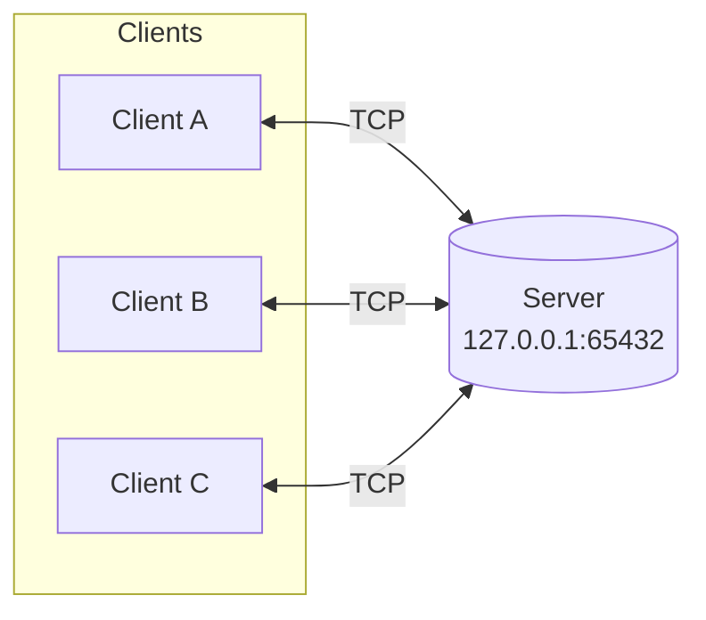
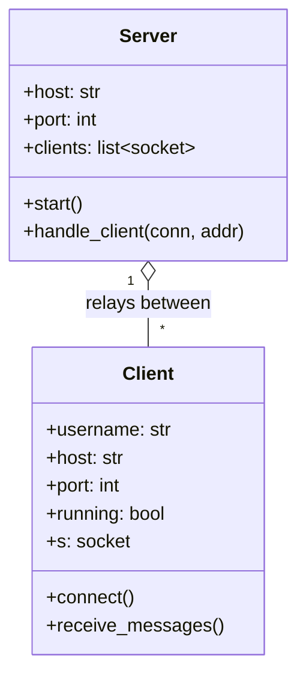
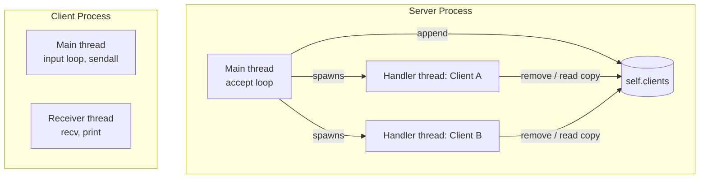
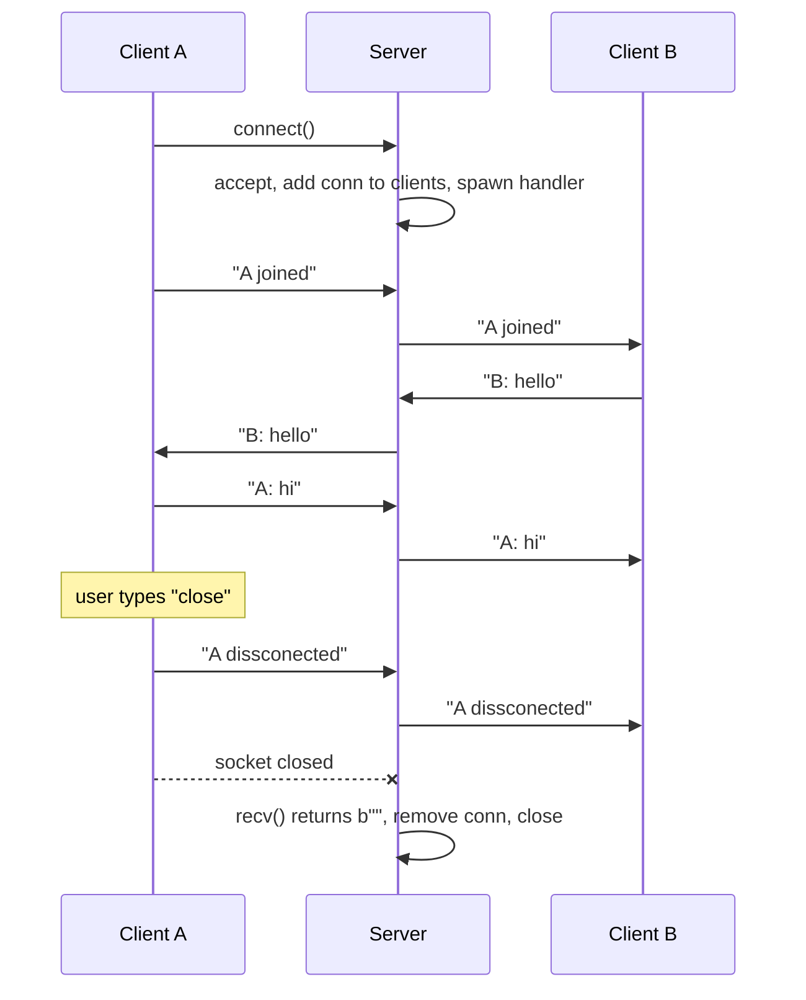
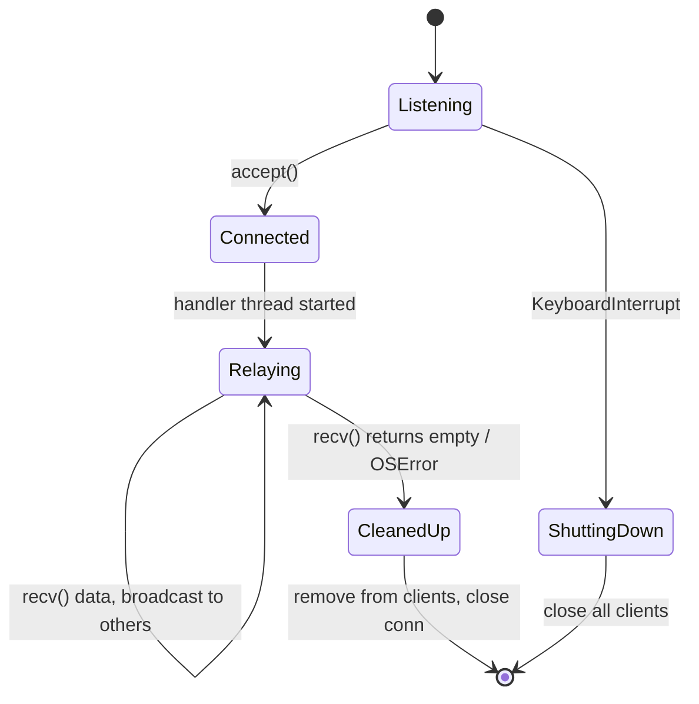
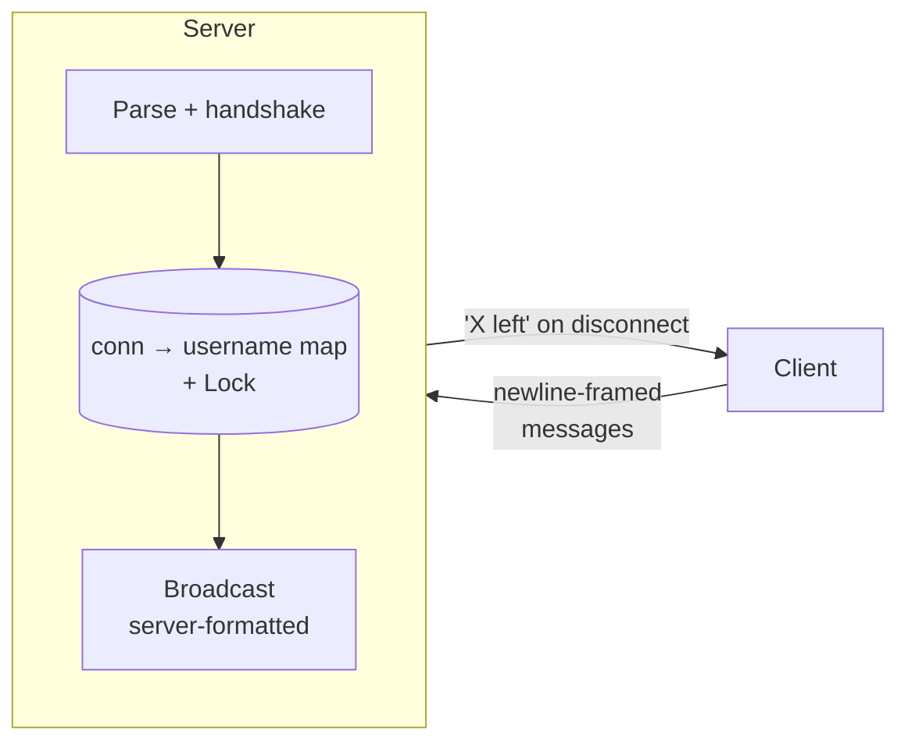

# Architecture

A multi-client TCP chat built on Python's `socket` and `threading` modules. One server relays every message to all other connected clients.

## 1. System Overview

- **Topology:** star. Clients never talk to each other directly.
- **Transport:** TCP (`SOCK_STREAM`), IPv4.
- **Server role:** accept connections, relay each received chunk to every client except the sender.
- **Client role:** send user input, print incoming messages.

## 2. Components

| Component | Responsibility |
|---|---|
| `Server.start()` | Binds, listens, accepts connections in a loop (1s timeout so Ctrl+C is responsive), spawns one thread per client |
| `Server.handle_client()` | Reads from one client, broadcasts to all others, cleans up on disconnect |
| `Client.connect()` | Connects, sends join message, starts receiver thread, runs the input loop on the main thread |
| `Client.receive_messages()` | Background thread that prints incoming data |

## 3. Threading Model

- **Server:** thread-per-connection. All handler threads are daemons.
- **Client:** main thread blocks on `input()`; a daemon thread blocks on `recv()`.
- **Shared state:** `Server.clients`. Broadcast iterates over `.copy()` to avoid mutation during iteration. There is currently no lock.

## 4. Sequence: Join, Chat, Leave

## 5. Server Connection Lifecycle

## 6. Wire Protocol

Plain UTF-8 text. No framing, no headers.

| Event | Payload (sent by client, relayed verbatim) |
|---|---|
| Join | `<username> joined \n \n` |
| Message | `<username>: <text>\n` |
| Leave | `<username> dissconected \n` |

The server does not parse messages. It forwards raw bytes.

## 7. Configuration

Loaded from `.env` via `python-dotenv`.

| Variable | Used by | Default |
|---|---|---|
| `SERVER_HOST` | server | `127.0.0.1` |
| `SERVER_PORT` | server | `65432` |
| `CLIENT_HOST` | client | `127.0.0.1` |
| `CLIENT_PORT` | client | `65432` |

## 8. Known Limitations

| Area | Issue |
|---|---|
| Framing | TCP is a byte stream. `recv(2048)` may return partial or merged messages |
| Concurrency | `clients` list is mutated across threads without a lock |
| Identity | Server doesn't know usernames. Clients format messages, so spoofing is possible |
| Disconnects | Leave notice is client-sent. A crashed client is never announced |
| Backpressure | A slow client blocks broadcast (`sendall` is blocking) |
| UI | Incoming prints can interleave with the `input()` prompt |
| Scale | Thread-per-client doesn't scale to thousands of connections |

## 9. Target Architecture (Planned)

Planned changes, in order:

1. Newline framing with per-connection buffers.
2. Server-side usernames; server formats and broadcasts join/leave.
3. `threading.Lock` around `clients`.
4. Rewrite with `asyncio` streams or `selectors` for comparison.
5. JSON or length-prefixed protocol, then TLS.
